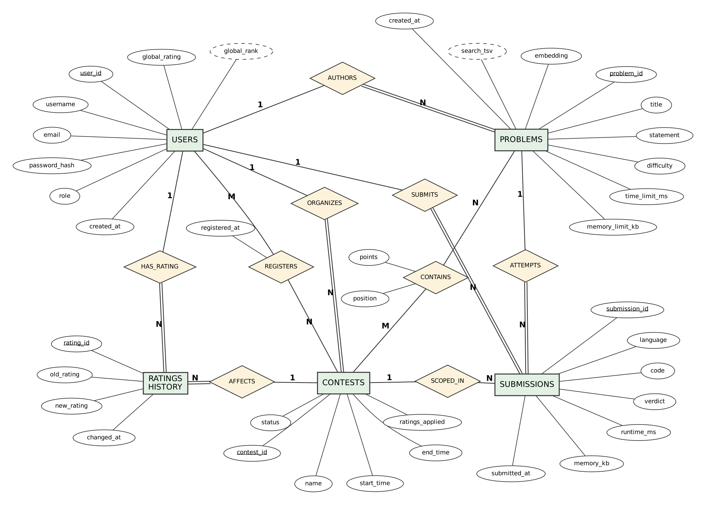

# CP Judge: Project Documentation

DBMS Experiential Learning, Level 3 Project

**Team:** Akulkrishna M S, Harsh M
**Project title:** _(to fill in)_

---

## 1. Problem statement

_(to write)_

## 2. Objectives

_(to write)_

## 3. Scope

_(to write)_

## 4. Functional requirements

_(to write)_

## 5. ER diagram

The ER diagram uses Chen notation: rectangles are entities, diamonds are relationships, ellipses are attributes (underlined = primary key, dashed = derived), and a double line means total participation. There are five entities: USERS, PROBLEMS, CONTESTS, SUBMISSIONS and RATINGS_HISTORY. Two relationships are M:N (REGISTERS between users and contests, CONTAINS between contests and problems); the others are 1:N. SCOPED_IN is partial because practice submissions do not belong to a contest. global_rank is derived from ratings by a trigger, and search_tsv is generated from the title and statement.

## 6. Relational schema

The ER diagram was converted to tables with these rules: each entity became a table with its own primary key; each 1:N relationship became a foreign key on the N side (for example problems.author_id); each M:N relationship became a junction table with a composite primary key (contest_registrations, contest_problems), and relationship attributes became its columns (registered_at, points, position). Total participation became NOT NULL, and partial participation allows NULL (submissions.contest_id, where NULL means a practice submission). Delete rules follow the meaning of the data: RESTRICT protects problems and authors that are still referenced, CASCADE removes rows that mean nothing without their parent, and SET NULL keeps a deleted contest’s submissions as practice submissions. UNIQUE constraints enforce real rules, for example one rating change per user per contest.
## 7. Database choice and justification

**PostgreSQL (structured data).** Users, problems, contests, submissions and ratings have a fixed format and are closely connected; for example, a submission belongs to a user, a problem and possibly a contest. This data must stay correct, so we use PostgreSQL: foreign keys keep the links valid, CHECK constraints and triggers reject bad data (for example, registering after a contest has ended), transactions make finalizing a contest all-or-nothing, and JOINs produce results like the contest standings.

**MongoDB (semi-structured data).** Test cases and judge logs have a known shape, but their number and size vary a lot from problem to problem. They never need JOINs, and the judge always reads all test cases of one problem at once. MongoDB stores them as one document per problem, fetched in a single read by `problem_id`. Validators still enforce the shape of each document.

**pgvector (meaning-based search).** To find similar problems, each problem statement is turned into an embedding of 384 numbers, so statements with similar meaning have nearby vectors. We use pgvector inside PostgreSQL, so the vector is stored in the same row as the problem and similarity search can be combined with normal SQL filters, with no extra service.

**How they connect.** PostgreSQL is the source of truth. MongoDB documents refer to it by ID (`test_cases.problem_id`, `execution_logs.submission_id`).

"Why not one database for everything?”
Users and submissions are connected data. In PostgreSQL each fact is stored once and linked by foreign keys (normalization), and the database enforces rules across tables with constraints and triggers. In MongoDB we’d have to copy data into documents (update anomalies) and couldn’t enforce links between collections.

## 8. Data dictionary / schema description

## 8. Data dictionary / schema description

Key: **PK** primary key, **FK** foreign key, **UQ** unique, **NN** NOT NULL. Every column marked NN cannot be empty.
All rules below are enforced by the database itself (constraints and triggers), not only by the application.

### 8.1 PostgreSQL tables

#### `users`: everyone who uses the platform

| Column | Type | Constraints | Description |
|---|---|---|---|
| user_id | SERIAL | PK | Auto-generated user number |
| username | VARCHAR(30) | NN, UQ, CHECK 3–30 letters, digits or `_` | Login name, shown on standings |
| email | VARCHAR(255) | NN, UQ, CHECK email format | Contact email, one account per email |
| password_hash | TEXT | NN | bcrypt hash; the plain password is never stored |
| role | VARCHAR(12) | NN, DEFAULT `'contestant'`, CHECK `admin` or `contestant` | Decides what the user may do |
| global_rating | INT | NN, DEFAULT 1200, CHECK 0–4000 | Current rating, changed only by `finalize_contest()` |
| global_rank | INT | CHECK ≥ 1 | Position on the leaderboard; **derived**, kept up to date by a trigger |
| created_at | TIMESTAMPTZ | NN, DEFAULT now() | When the account was created |

#### `problems`: programming problems

| Column | Type | Constraints | Description |
|---|---|---|---|
| problem_id | SERIAL | PK | Auto-generated problem number |
| author_id | INT | NN, FK → users, ON DELETE RESTRICT | Admin who wrote it (trigger checks the author is an admin) |
| title | VARCHAR(150) | NN, UQ | Problem name |
| statement | TEXT | NN | Full problem text |
| difficulty | INT | NN, CHECK 800–3500 | Difficulty rating |
| time_limit_ms | INT | NN, DEFAULT 2000, CHECK 100–10000 | Maximum run time per test case |
| memory_limit_kb | INT | NN, DEFAULT 262144, CHECK 16384–1048576 | Maximum memory |
| embedding | vector(384) | NULL until computed | Meaning of title + statement, used for similar problems |
| search_tsv | tsvector | GENERATED ALWAYS (STORED) | Words of the title (weight A) and statement (weight B) for full-text search |
| created_at | TIMESTAMPTZ | NN, DEFAULT now() | When it was added |

#### `contests`: timed contests

| Column | Type | Constraints | Description |
|---|---|---|---|
| contest_id | SERIAL | PK | Auto-generated contest number |
| organizer_id | INT | NN, FK → users, ON DELETE RESTRICT | Admin who created it |
| name | VARCHAR(150) | NN, UQ | Contest name |
| start_time | TIMESTAMPTZ | NN | Start (stored in UTC) |
| end_time | TIMESTAMPTZ | NN, CHECK end_time > start_time | End |
| status | VARCHAR(10) | NN, DEFAULT `'upcoming'`, CHECK `upcoming`, `running`, `finished` | Set to `finished` when finalized |
| ratings_applied | BOOLEAN | NN, DEFAULT FALSE | TRUE after finalize; stops ratings being applied twice |

#### `contest_problems`: which problems are in which contest (M:N, from CONTAINS)

| Column | Type | Constraints | Description |
|---|---|---|---|
| contest_id | INT | PK (part), FK → contests, ON DELETE CASCADE | The contest |
| problem_id | INT | PK (part), FK → problems, ON DELETE RESTRICT | The problem |
| points | INT | NN, DEFAULT 100, CHECK > 0 | Points for solving it in this contest |
| position | INT | NN, CHECK > 0, UQ with contest_id | Order in the contest (A, B, C…); no two problems share a position |

#### `contest_registrations`: who joined which contest (M:N, from REGISTERS)

| Column | Type | Constraints | Description |
|---|---|---|---|
| contest_id | INT | PK (part), FK → contests, ON DELETE CASCADE | The contest |
| user_id | INT | PK (part), FK → users, ON DELETE CASCADE | The user; the composite PK stops double registration |
| registered_at | TIMESTAMPTZ | NN, DEFAULT now() | When they registered (a trigger rejects registration after the contest ends) |

#### `submissions`: every code submission

| Column | Type | Constraints | Description |
|---|---|---|---|
| submission_id | BIGSERIAL | PK | Auto-generated; BIGSERIAL because this table grows fastest |
| user_id | INT | NN, FK → users, ON DELETE CASCADE | Who submitted |
| problem_id | INT | NN, FK → problems, ON DELETE RESTRICT | Which problem |
| contest_id | INT | FK → contests, ON DELETE SET NULL | The contest, or **NULL for a practice submission** (trigger checks registration and contest time) |
| language | VARCHAR(20) | NN, CHECK `python`, `cpp`, `c`, `java`, `javascript` | Programming language |
| code | TEXT | NN, CHECK length 1–65536 | Source code |
| verdict | VARCHAR(10) | NN, DEFAULT `'PENDING'`, CHECK `PENDING`, `RUNNING`, `AC`, `WA`, `TLE`, `MLE`, `RE`, `CE` | Judge result |
| runtime_ms | INT | CHECK ≥ 0 | Slowest test case time; NULL until judged |
| memory_kb | INT | CHECK ≥ 0 | Memory used; NULL until judged |
| submitted_at | TIMESTAMPTZ | NN, DEFAULT now() | Submission time, used for contest penalty and ordering |

#### `ratings_history`: one row per user per rated contest

| Column | Type | Constraints | Description |
|---|---|---|---|
| rating_id | SERIAL | PK | Auto-generated |
| user_id | INT | NN, FK → users, ON DELETE CASCADE | Whose rating changed |
| contest_id | INT | NN, FK → contests, ON DELETE CASCADE | Which contest caused it |
| old_rating | INT | NN, CHECK 0–4000 | Rating before |
| new_rating | INT | NN, CHECK 0–4000 | Rating after (a trigger copies it to `users.global_rating`) |
| changed_at | TIMESTAMPTZ | NN, DEFAULT now() | When it was applied |
| | | UQ (user_id, contest_id) | At most one rating change per user per contest |

#### View `contest_standings`

Not a table: a saved query that joins `submissions`, `contest_problems` and `contest_registrations` and ranks users in each contest by score, then by solve time. The standings page and `finalize_contest()` both read it, so they always agree.

### 8.2 MongoDB collections

Each document refers to PostgreSQL by ID. A `$jsonSchema` validator checks the shape of every document.

#### `test_cases`: one document per problem

| Field | Type | Rules | Description |
|---|---|---|---|
| problem_id | int | required, ≥ 1, **unique index** | Links to `problems.problem_id` |
| cases | array | required, at least 1 item | All test cases of the problem |
| cases[].input | string | required | Input given to the program |
| cases[].expected_output | string | required | Correct output |
| cases[].is_sample | bool | | TRUE = shown on the problem page; FALSE = hidden, never sent to the browser |
| cases[].weight | int or double | | Weight of the case |

#### `execution_logs`: one document per judged submission

| Field | Type | Rules | Description |
|---|---|---|---|
| submission_id | int or long | required, **unique index** | Links to `submissions.submission_id` |
| compile_output | string or null | | Compiler errors (for C, C++, Java) |
| per_case | array | | One entry per test case run: `case_idx`, `verdict`, `time_ms`, `stdout` (first 500 characters), `stderr`; judging stops at the first failing case |
| judged_at | date | required, indexed | When judging finished |

## 9. SQL / NoSQL / vector database implementation

_(to write)_

## 10. Important queries

_(to write)_

## 11. System architecture

_(to write)_

## 12. Application screenshots

_(to add)_

## 13. Testing results

_(to write)_

## 14. Conclusion and future enhancements

_(to write)_
